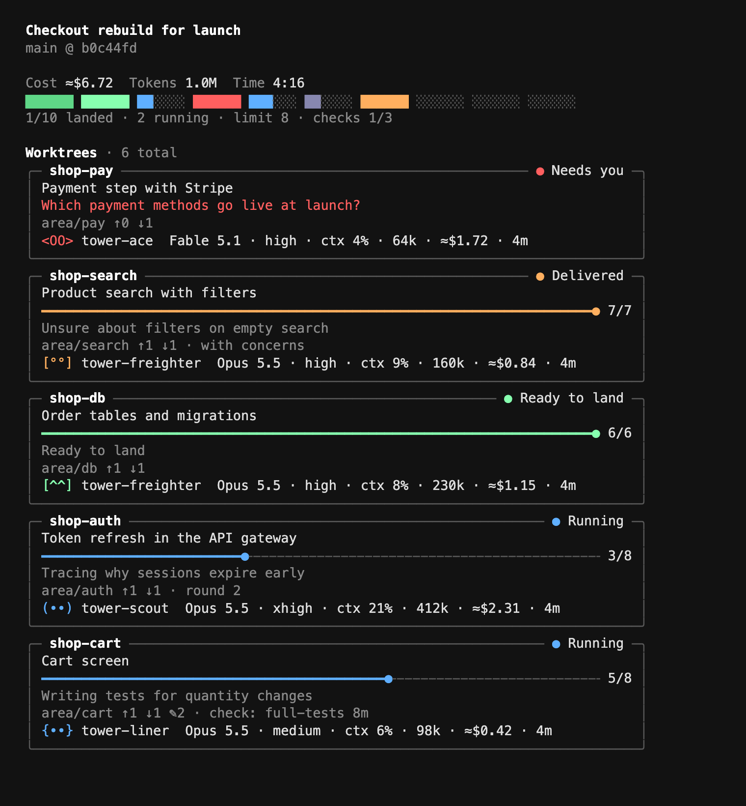
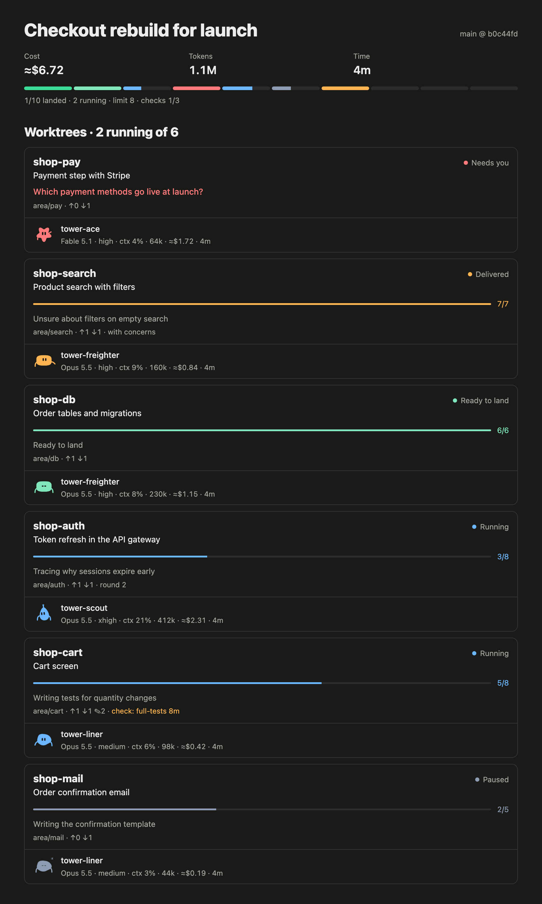

<p align="center">
  
</p>

<p align="center">
  <a href="https://github.com/noxpublishing/agent-watchtower/actions/workflows/test.yml"></a>
  <a href="LICENSE"></a>
  
  
  
</p>

<p align="center">
  <b>Split a big job across coding agents in git worktrees, watch all of them live, and land their work on main one at a time.</b>
</p>

Watchtower turns one session into a tower. It plans the work, starts a worker per worktree, reads what comes back, and lands it. You choose how many fly and make the decisions that are yours. The rest of the time you can see everything without asking.

## Install

**Claude Code**, at the prompt of a terminal session:

```text
/plugin install watchtower --marketplace noxpublishing/agent-watchtower
```

From a shell:

```bash
claude plugin install watchtower --marketplace noxpublishing/agent-watchtower
```

In the desktop app, click + next to the prompt box, then Plugins, Add marketplace with `noxpublishing/agent-watchtower`, then Add plugin.

**Codex**, or both clients from one checkout that `git pull` keeps current:

```bash
git clone https://github.com/noxpublishing/agent-watchtower ~/agent-watchtower
```

```bash
~/agent-watchtower/scripts/tower-install.sh codex
```

Use `all` instead of `codex` to also link it into `~/.claude/skills`. Pick one way per client, so Claude Code does not load it twice. Then start a new session.

### Live activity in Codex desktop

With Python 3.8 or newer, run `scripts/tower-install.sh codex-live` from the Watchtower checkout. Review the Watchtower entries in **Settings → Hooks** (`/hooks` in the CLI), then start a new local Codex chat in your project.

Run `python3 ~/.codex/skills/watchtower/scripts/tower-codex.py board` from the project and open the printed address in Codex's built-in browser. The pane shows the flight plan and actual Codex sessions and subagents as they work, go idle, or report an interruption. Workers associate themselves with their assigned worktrees through their normal progress reports. Start the board before the turn you want to follow. Stop the foreground server with Ctrl+C.

The board listens on loopback and enables capture for that repository. Watchtower keeps the last activity state in the shared Git directory and expires records after 24 hours. The hooks store identifiers and lifecycle metadata only. To disable capture, disable the Watchtower entries in **Settings → Hooks**.

## Start

Open any repository or empty folder and say:

> Set up watchtower. I want to `<your goal>`.

`watchtower-setup` reads the repository first and works out whether this is a new project, an existing one or a takeover of stalled work. It asks only what it could not find: the goal, what done means, what it may do alone, and how many agents should fly. It writes a flight plan, and nothing starts until you confirm it.

Already know what you want? Skip the interview:

> Use watchtower on this repo. Goal: `<what should be true at the end>`. Look at what's here, including open branches, and propose the order.

## What you see

Nobody has to report progress to you. Workers write it to a shared state folder with one silent command, and every view reads that folder. Watching wakes no agent and costs no tokens.

### In Claude Code

A bar above the prompt shows the whole fleet: one slot per worktree, how many run, how many landed.

<p align="center"></p>

The Fleet panel opens beside the chat once a plan exists, and `/tower-board` toggles it. Worktrees come first, most urgent on top, each with the agents working in it. Agents with no worktree of their own, such as a reviewer, get their own list.

<table>
<tr>
<td width="50%"></td>
<td>

**Top:** estimated cost, tokens and time for the whole fleet.

**Each worktree:** its name and state, the task, steps done, the step in progress, commits ahead and behind the base, uncommitted files, a running check.

**Each agent:** class, model, effort, context fill, tokens, cost and time.

**Below:** areas still planned, areas landed, and worktrees nobody planned, which a takeover needs to see.

A question that waits for you shows in red at the top of the list.

</td>
</tr>
</table>

### In a terminal, or beside Codex

```bash
scripts/tower-deck.sh
```

This opens a full-screen live deck: a pane on the right in tmux, a window of its own on macOS. Keys: `q` quit, `l` landed, `c` compact, `j` and `k` scroll.

<p align="center"></p>

### In a browser

`scripts/tower-board.sh --html --watch` keeps a local page current, with no server. It prints the address.

<details>
<summary>See the page</summary>
<p align="center"></p>
</details>

<sub>All pictures show a demo fleet. The panel and the bar are the plugin's own drawings, and the deck is the script's real output.</sub>

## How a shift runs

<p align="center"></p>

1. **Interview.** The setup skill reads the repository and asks what is open. A new project gets a spec and a foundation area first, because parallel agents on an empty repository each invent their own structure.
2. **Flight plan.** Each area gets a worker class, its dependencies and the files it owns. A preflight refuses two areas owning the same path without an order between them, dependency cycles and placeholder titles.
3. **Fly.** `tower-area.sh launch` creates the worktree and branch and opens the gate. Expensive checks wait in a shared queue with a time limit, so a hung test stops itself and says so.
4. **Review.** A worker's report is a claim. The tower reads the diff, or sends a read-only inspector that never saw the work. Defects go back with a precise list. After two returns the tower re-plans or asks you.
5. **Land.** Fast-forward only. `mark land` refuses a commit that is not on the base or is no newer than where the area started. After a landing the next area flies.

The plan lives in `.git/watchtower`, shared by all worktrees and impossible to commit. When a long conversation gets compacted, the board and `git log` still say what is done, so finished work is not started twice.

## You set the fleet size

No number is built in. `tower-capacity.sh` reads your cores, memory and load and suggests one. You pick any number, or no limit.

```text
machine: 12 cores, 16 GB RAM, 4 GB available, load 3.1
limits:  flying no limit, runways 3
suggest: up to 6 flying, 3 runways
         estimate: 4 GB for the system, 2 GB per heavy check, 1 GB per agent
```

The number worth watching is how many candidates need another rebase after each landing. Every landing makes the others stale, so twenty agents are not twenty times faster than one. Your client's own agent limit still applies, and the tower names it instead of working around it.

## Workers

Each area gets the cheapest class that should get it right the first time. In Claude Code a class sets model and effort. In Codex it keeps your model and sets effort. The body shape is the class, and what the avatar does is the state: it works, reads along in review, cheers once landed, sleeps while paused and waves when it needs you.

<p align="center"></p>

| Class | Claude Code | For |
|---|---|---|
| `ace` | Fable, high | The hardest problems. A reserve, not a default. |
| `scout` | Opus, xhigh | Finding out: unfamiliar code, unclear root cause. |
| `freighter` | Opus, high | Delicate work with a clear approach: multi-file changes, migrations. |
| `liner` | Opus, medium | Standard features and fixes with clear requirements. |
| `prop` | Sonnet, low | Nothing left to figure out: renames, config, boilerplate. |
| `tower-inspector` | Opus, high | Reads a candidate cold before it lands. Changes nothing. |

Design stays with the tower. Workers do not invent what a user will see.

## The seven laws

1. **You set the fleet size.** Your machine, your limits, your call.
2. **Only the tower lands.** One writer on the base branch means one place that knows its state.
3. **Heavy checks use the runway.** A shared queue with a time limit.
4. **Reports are claims, evidence decides.** "Landed" on the board means the script found the commit on the base.
5. **Check your own landings hardest.** A fix that passes alone can break its neighbours. CI comes before the next landing.
6. **Decide routine, record it, ask the rest.** Naming and test approach get decided and logged. Law, money, accounts, publishing and deletion go to you, as options.
7. **Waiting is not reporting.** Every wake-up costs tokens. Progress goes to the board, messages carry results.

## What it's for

Anything too big for one agent that can be split and verified:

| You have | Say something like |
|---|---|
| **A product idea or spec** | *Build this spec with watchtower. Foundation first, then the areas in blocks.* |
| **A big feature across the stack** | *Add `<feature>` across API, app and docs. You orchestrate.* |
| **A backlog** | *Work through these 15 issues. Group the ones that touch the same files.* |
| **A migration or large refactor** | *Move all modules from `<old>` to `<new>`, in batches, with main green the whole time.* |
| **Stalled agents and old branches** | *Take over these worktrees and get what's worth keeping onto main.* |
| **A red main and a pile of work** | *CI is red and six branches are waiting. Sort this out.* |
| **Sessions stopped by a limit** | *Limits are back. Resume the stopped sessions, most important first.* |

One small change a single agent can finish does not need any of this.

## The traps it knows about

Watchtower came out of one real project with more than twenty parallel sessions, and at one point 16 checks waiting on 3 slots for over an hour. All of these happened. [The full list](references/failure-modes.md) says what each looks like and what to do.

> **Counters that merge wrong.** Two branches change `tables: 84` to `tables: 88`. Git sees the same edit and merges it without a word. The truth was 92.

> **The lock file that lost Linux.** A local install dropped entries for other platforms. Green on the laptop, `npm ci` fails in CI.

> **The hotfix that passed alone.** It fixed the hanging suite and broke every suite after it, which only showed in a full run.

> **The pre-check that checked nothing.** A shell loop reported "no conflicts". It never split its list. The real cherry-pick had twelve.

## The scripts on their own

They work without any agent, in any git repository, and need only bash and git.

| Script | What it does |
|---|---|
| `tower-survey.sh` | What a repository can tell before anyone asks. Changes nothing. |
| `tower-capacity.sh` | Reads the machine, suggests numbers, stores your choice per repository. |
| `tower-area.sh` | The flight plan: add, edit, preflight, launch, worker reports, review states, landing, rulings. |
| `tower-board.sh` | The fleet at a glance: terminal, live page, plain text or JSON. |
| `tower-deck.sh` | Opens the live board in a tmux pane or a window of its own. |
| `tower-gate.sh` | Who may fly. Refuses past a limit only if you set one. |
| `runway.sh` | Runs heavy checks in a queue with a time limit that also stops child processes. |
| `land-check.sh` | Before landing: commits, deletions, shared infrastructure, possible secrets, a merge simulation. |
| `tower-overlap.sh` | Which branches touch the same files. |
| `tower-init.sh` | Sets up the shared state folder. |
| `tower-install.sh` | Links the skills and writes the Codex worker classes. |

```bash
scripts/tower-init.sh
scripts/tower-area.sh add search "Product search" --owns src/search
scripts/tower-area.sh launch search
scripts/runway.sh full-tests npm test
scripts/tower-deck.sh
```

<details>
<summary><b>Exit codes and settings</b></summary>

| Exit from `runway.sh` | Meaning |
|---|---|
| 75 | Parked, not your turn. Commit and wait. |
| 124 | Hung past the time limit. Find the cause. |
| 143 | Aborted. Run it again. |
| 2 | Usage error, or a runway without an owner. Inspect it. |
| other | The command's own result |

| Setting | Default | |
|---|---|---|
| `TOWER_MAX_ACTIVE` | no limit | Areas on the gate. Better: `tower-capacity.sh set --flying <n>` |
| `TOWER_RUNWAYS` | one per four cores | Checks at once. Better: `tower-capacity.sh set --runways <n>` |
| `TOWER_TIMEOUT` | 5400 | Seconds before a check counts as hung |
| `TOWER_KILL_GRACE` | 20 | Seconds between TERM and KILL |
| `TOWER_BASE` | origin's default | Base branch |
| `TOWER_HOME` | `.git/watchtower` | State folder |
| `TOWER_WORKTREES` | next to the repository | Where `launch` creates worktrees |
| `TOWER_LANG` | system language | `de` or `en` for the panel and the deck |

</details>

<details>
<summary><b>Which tools does it work with?</b></summary>

| | Sessions | Board |
|---|---|---|
| Claude Code desktop app | Starts, messages and hands over sessions directly | Bar and side panel |
| Claude Code in a terminal | Subagents, or one session per tmux pane | Bar and panel in fullscreen rendering, or the deck |
| Codex | Explicit worktree dispatch, worker classes, handoff when usage and detach tools are absent | Live activity in the built-in browser, or terminal deck |
| Cursor and others | That tool's own way of running sessions. Not tested. | Deck or browser page |

See [the harness notes](references/harness.md).

</details>

## Honest limits

- It comes from one large project and has not been benchmarked. The numbers above describe that run, not a promise.
- Costs are estimates: reported tokens times list prices. On a subscription you do not pay them. Codex reports no tokens to the board, so cost and context stay empty there.
- The side panel uses Claude Code's early-access plugin hooks, tested on 2.1.318. They can change between releases. The terminal and browser boards do not depend on them.
- Only one plugin can draw the row above the prompt at a time. While another plugin's bar is showing, this one stays hidden until that one is dismissed.
- The gate and the worker classes depend on the agent following its brief. A worker that ignores them is not physically stopped from editing.
- It does not replace your tests or CI. It runs them in an order you can afford.

## Contributing

Bring your own failure modes: if parallel agents burned you in a way that isn't [on the list](references/failure-modes.md), open an issue or a pull request. Run `bash tests/run.sh` before you do, and `claude plugin test .` if you touch the plugin. [Evaluating Watchtower](references/evaluation.md) covers the rest.

## License

[MIT](LICENSE)
