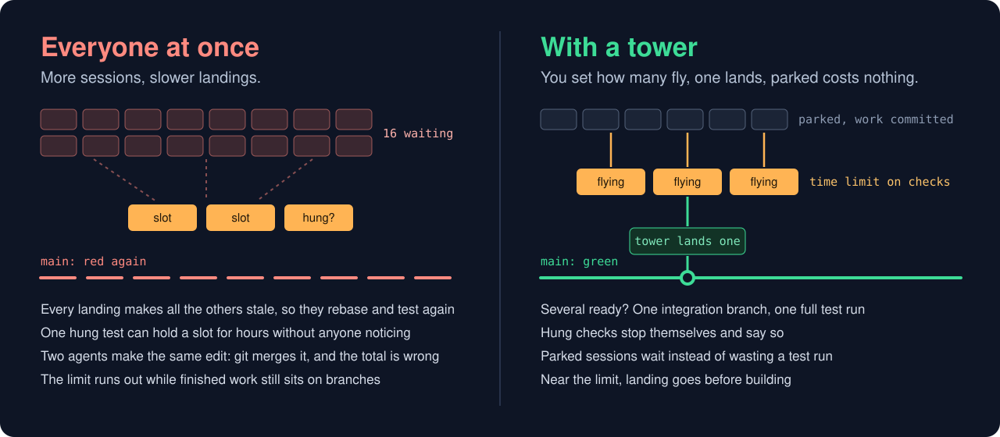
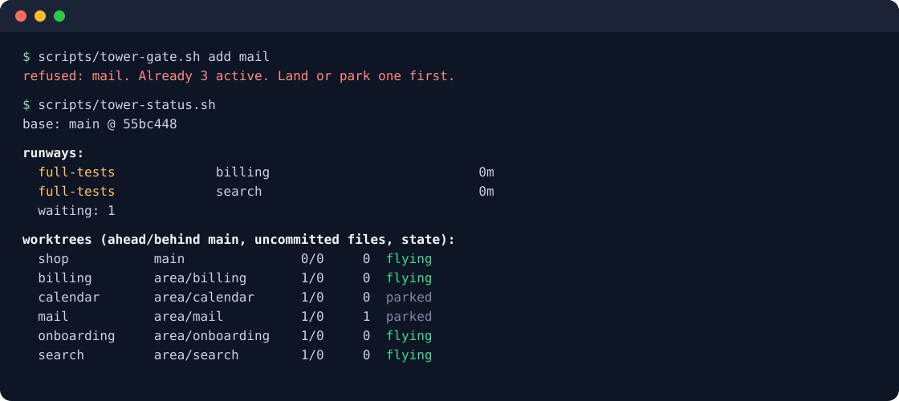

<p align="center">
  
</p>

<p align="center">
  <a href="https://github.com/noxpublishing/agent-watchtower/actions/workflows/test.yml"></a>
  <a href="LICENSE"></a>
  
  
</p>

<p align="center">
  <b>One session becomes the tower. A few agents fly. Finished work lands on main, one at a time.</b>
</p>

```bash
git clone https://github.com/noxpublishing/agent-watchtower ~/.claude/skills/watchtower
```

## Start it

Install once, open your agent in any repository or empty folder, and say what you want. Mention *watchtower*, or type `/watchtower` if your tool has slash commands.

<table>
<tr><th width="50%">Starting something new</th><th width="50%">Already have a project</th></tr>
<tr>
<td>

> Use watchtower. I want to build `<your idea or plan>`. Set up the foundation first, split the rest into areas, and show me the order before you start.

The tower has one session lay the foundation: structure, test command, CI and shared contracts. Parallel agents on an empty repository would each invent their own. Then the areas fly in blocks.

</td>
<td>

> Use watchtower on this repo. Goal: `<what should be true at the end>`. Look at what's here, including open branches, and propose the order.

The tower reads your rules, CI and branches, backs up what isn't merged, and asks only what is really yours to decide. Then it starts the first block.

</td>
</tr>
</table>

### What it's for

Anything too big for one agent that can be split and verified:

| You have | Say something like |
|---|---|
| **A product idea or spec** | *Build this spec with watchtower. Foundation first, then three areas at a time.* |
| **A big feature across the stack** | *Add `<feature>` across API, app and docs. You orchestrate.* |
| **A backlog** | *Work through these 15 issues. Group the ones that touch the same files.* |
| **A migration or large refactor** | *Move all modules from `<old>` to `<new>`, in batches, with main green the whole time.* |
| **Quality work in many places** | *Raise test coverage in the weakest modules, one area per agent.* |
| **Stalled agents and old branches** | *Take over these worktrees and get what's worth keeping onto main.* |
| **A red main and a pile of work** | *CI is red and six branches are waiting. Sort this out.* |
| **Sessions stopped by a limit** | *Limits are back. Resume the stopped sessions, most important first.* |
| **Limits draining too fast** | *We're burning through usage. Fix how the agents run.* |

Not worth it for one small change a single agent can finish. Just ask that agent.

## Twenty agents are not twenty times faster

Starting a pile of agents feels great for about an hour. Then they queue for the same machine, every landing makes the others stale, a hung test holds a slot all afternoon, `main` turns red, and your usage limit is gone with half the work still on branches.

Watchtower came out of exactly that: one real project, more than twenty parallel sessions, and at one point 16 checks waiting on 3 slots for over an hour. What finally worked was almost embarrassingly simple.

<p align="center">
  
</p>

## How it works

<p align="center">
  
</p>

## The six laws

1. **Few fly at once.** Three active areas by default, the rest park. Every landing forces everyone still flying to rebase and retest, so fewer flying means less repeated work.
2. **Only the tower lands.** One writer on the base branch means one place that knows its state.
3. **Heavy checks use the runway.** A shared queue with a time limit, so a hung test stops itself and says so.
4. **Check your own landings hardest.** A fix that passes alone can break its neighbours. CI comes before the next landing.
5. **Decide routine, ask the rest.** Naming and test approach get decided. Law, money, accounts, publishing and deletion go to you, as options.
6. **Waiting is not reporting.** Every wake-up costs tokens. Sessions report results, not "still waiting".

## What's in the box

<p align="center">
  
  <br><sub>Output from a demo repository, shortened to fit.</sub>
</p>

| Script | What it does |
|---|---|
| `tower-gate.sh` | Decides who may fly. A fourth area gets refused until one lands. |
| `runway.sh` | Runs heavy checks first come, first served, with a time limit that also stops child processes. `--priority` lets a fix for a red main overtake. |
| `tower-status.sh` | Runways, queue, every worktree and CI, on one screen. |
| `land-check.sh` | Before landing: commits, deletions, shared infrastructure, possible secrets, and a merge simulation. |
| `tower-overlap.sh` | Which branches touch the same files, so they don't fly together. |
| `tower-init.sh` | Sets up shared state in `.git/watchtower`: visible to all worktrees, impossible to commit. |

And for the agent itself:

- **[Takeover](references/takeover.md):** adopt yesterday's stalled worktrees and sessions, including a `main` that is already red.
- **[Landing](references/landing.md):** when a rebase is yours and when it goes back to the session, and how several candidates share one full test run.
- **Shift change:** a very long orchestrator conversation pays for its history on every message, so a fresh one takes over from a handoff file.
- **Budget:** a stop line agreed with you. Near the limit, landing goes before building.

## The traps it knows about

All of these really happened. [The full list](references/failure-modes.md) has what each looks like and what to do.

> **Counters that merge wrong.** Two branches change `tables: 84` to `tables: 88`. Git sees the same edit and merges it without a word. The truth was 92.

> **The lock file that lost Linux.** A local install dropped entries for other platforms. Green on the laptop, `npm ci` fails in CI.

> **The hotfix that passed alone.** It fixed the hanging suite and broke every suite after it, which only showed in a full run.

> **Failures that move around.** Different tests fail each run, each green alone. One suite left a job behind, and 30 minutes later a timer revived it inside someone else's test.

> **The pre-check that checked nothing.** A clever shell loop reported "no conflicts". It never split its list. The real cherry-pick had twelve.

## The scripts on their own

They work without any agent, in any git repository:

```bash
scripts/tower-init.sh
scripts/tower-gate.sh add search billing
scripts/runway.sh full-tests npm test
scripts/tower-status.sh
scripts/land-check.sh feature/search
```

<details>
<summary><b>Exit codes and settings</b></summary>

| Exit from `runway.sh` | Meaning |
|---|---|
| 75 | Parked, not your turn. Commit and wait. |
| 124 | Hung past the time limit. Find the cause. |
| 143 | Aborted. Run it again. |
| other | The command's own result |

| Setting | Default | |
|---|---|---|
| `TOWER_RUNWAYS` | 3 | Checks running at once |
| `TOWER_MAX_ACTIVE` | 3 | Areas on the gate |
| `TOWER_TIMEOUT` | 5400 | Seconds before a check counts as hung |
| `TOWER_BASE` | origin's default | Base branch |
| `TOWER_HOME` | `.git/watchtower` | State directory |

</details>

<details>
<summary><b>Which tools does it work with?</b></summary>

| | Sessions | Scripts and method |
|---|---|---|
| Claude Code desktop app | Starts, messages and hands over sessions directly. This is where it was developed. | Yes |
| Claude Code in a terminal | Subagents, or one session per tmux pane | Yes |
| Codex, Cursor and others | Use that tool's own way of running sessions. Not tested yet. | Yes |

Tests run on Linux and macOS. See [the harness notes](references/harness.md).

</details>

<details>
<summary><b>Why three?</b></summary>

Three is what worked in the run this came from, on one laptop. It's a starting point. If your checks are fast or you have more machines, raise `TOWER_MAX_ACTIVE` and `TOWER_RUNWAYS`. The thing to watch is how many candidates need another rebase after each landing.

</details>

<details>
<summary><b>Isn't this just <code>git worktree</code>?</b></summary>

Worktrees give each agent its own folder. They don't decide who runs, who lands, what to do with a hung test, or when to ask you. Watchtower is that part.

</details>

## Honest limits

- It comes from one large project and has not been benchmarked. The numbers above describe that run, not a promise.
- It doesn't replace your tests or CI. It runs them in an order you can afford.
- An agent following a skill can still make mistakes. The tower's own hotfix is on the list of traps for a reason.

## Contributing

Bring your own failure modes: if parallel agents burned you in a way that isn't [on the list](references/failure-modes.md), open an issue or a pull request. Run `bash tests/run.sh` before you do.

If Watchtower saves your main branch, a star helps others find it.

## License

[MIT](LICENSE)
